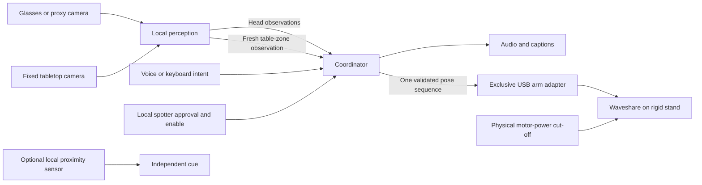

# PHAROS build plan

Four people · 36 hours

Use the [revised integration plan](PHAROS_Integration_Review.md) for current feature scope, owners and milestone decisions. This baseline gives the original tabletop fixture and bench plan.

PHAROS explores how camera-equipped glasses, audio cues, and a body-mountable arm could assist people with visual and upper-limb impairments. For judging, a seated participant requests a lightweight bottle, hears its approximate direction, and requests retrieval. The stand-mounted arm transfers the bottle from a marked pickup zone to a tray after a spotter approves. The participant accesses the tray after motion is disabled and the spotter clears it. Show the wearable fit separately with the drive supply and power-capable tether disconnected.

## Start in parallel

At kickoff, write one name beside each role in the team's shared notes, select the demo object and tray, and agree on the [v1 contracts](PHAROS_Interfaces.md). The plan uses role names until the team assigns people. If starting late, spend the first 15 minutes here, then jump to the current time gate. Keep one arm operator and one spotter for powered sessions.

| Owner and write area | First 30–60 minutes | Deliverable and handoff |
| --- | --- | --- |
| A · Perception and Jetson · `src/pharos/perception/` | Start fixed-camera detection on a laptop or with a short labeled clip. Start the official Jetson setup in parallel if storage is available. Generate sample detections for both camera roles. | B gets the table-zone overlay. C gets left/center/right observations. D gets live and replay adapters, package pins, camera settings, and measured frame age. |
| B · Arm and safety · `src/pharos/arm/`, `config/bench.local.json` | Photograph SKU and controller labels, locate the exact manual, verify supply and supported USB transport, inspect startup behavior, and start the fake arm adapter. Work with D on the stand and zone. | D gets fake and model-specific adapters, model/firmware, verified pose plan, power-stop and recovery evidence. Only B or the designated replacement operates the live arm. |
| C · Glasses and interaction · `src/pharos/interaction/`, `firmware/glasses/` | Build push-to-talk intent mapping and prerecorded audio with mock events. Try the ESP32-S3 only after the board and camera are identified. Prepare a tethered camera or seated camera proxy. | D gets identical typed/proxy/voice intents and an audio/text announcer. A gets camera URL or USB device and frame format. C owns optional independent proximity cue. |
| D · Integration and demo · `src/pharos/coordinator.py`, `tests/`, submission | Publish v1 contract, shared fixture and mock launch path. Secure fixture materials with B, reserve test slots and draft submission. | All get the integrated mock run, release SHA, gate decisions and evidence. D owns merges, versioned fixture configuration template, fallback selection and demo clock. |

Work on short topic branches. Review boundary changes with both owners before merging. A and C can develop from sample observations, B from fake commands, and D from fake camera and arm adapters. Keep camera tooling, OS setup, head mount, and firmware off the path to the first verified stand pick. Use one dedicated host for the arm's USB connection. Keep a copy of the known-good commit, dependencies, audio and demo configuration on the laptop.

## Scope and system

**Core MVP**

- One upright, lightweight, empty plastic bottle. Use one tested geometry, no glass/liquid, a physical placement jig, and a fixed tray within the verified arm envelope. The target must be correctly seated in the jig. The fixed camera must see one qualified bottle in that zone before retrieval.
- Seated object guidance from a head-mounted camera or a camera proxy. Speak camera-relative left, center or right with a caption. A table camera can support both roles in a disclosed single-camera fallback.
- User requests find and retrieve through a restricted push-to-talk vocabulary. A keyboard or large-button panel exercises the same workflow. A separate local spotter confirmation is required for movement.
- Stand-only pick and tray placement with a physical motor-power cut-off, software stop, bounded teach points, and bench acceptance. Show static fit separately if B and D verify a secure supported mount with power disconnected. Use a dummy mass or mannequin if fit is uncertain.

**Stretch after core acceptance**, in order: use the actual ESP32-S3 glasses capture and Jetson together if either is still on fallback; standalone proximity warning with a local sensor and cue; second guidance-only object; second qualified pickup zone; richer audio or scene summaries. Proximity is a stationary demonstration of a local warning. Real-world walking guidance, body-contact assistance, and powered wearable motion are outside this sprint.



Prefer one Python process on Jetson or laptop. Use OpenCV for capture and either an offline lightweight detector or a distinctive, controlled marker/color cue for the single bottle. Recognition on head camera provides guidance. Table vision gates access to a known jig pose via an image-space region and fixture reference marks. Arm pose and joint bounds come from supervised teaching. See the [contracts](PHAROS_Interfaces.md) for timeouts, stop behavior, observation validation and payloads.

## Hardware and dependency decisions

| Dependency | Verify or obtain | Decision and fallback |
| --- | --- | --- |
| Jetson Orin Nano | Official developer kit versus third-party carrier, UEFI version, target microSD/NVMe, installer USB, correct PSU, display/keyboard and camera. | The NVIDIA developer-kit ISO workflow uses a USB installer and separate target storage. Verify the hardware and firmware path before flashing. If bring-up is incomplete at H7 or takes more than 60 min from first work, use the prepared laptop for integration. Stage Jetson work separately. [NVIDIA quick start](https://docs.nvidia.com/jetson/orin-nano-devkit/user-guide/quick_start.html) |
| Waveshare arm | Exact model/firmware, gripper and fasteners, documented power and startup behavior, known-good USB data cable, model-specific command and feedback support. | Keep fake arm until the manual and bench prerequisites are verified. Sample commands and limits for another model are unsuitable. [Waveshare M2-S reference](https://www.waveshare.com/wiki/RoArm-M2-S) · [Waveshare M3 reference](https://www.waveshare.com/wiki/RoArm-M3) |
| Stand and cut-off | Rigid base bolted/clamped to a stable table, physical disconnect within spotter reach, separation/marking, strain relief, unobstructed drop area. | D builds fixture, B qualifies it. Enable real movement only after [bench preflight](PHAROS_Bench_and_Demo.md). Use the hardware table for missing parts and demo simulation if the setup cannot be qualified. |
| Glasses | Exact ESP32-S3 board, sensor, PSRAM/pinout, mount and power. Bring UVC webcam plus spare data cables, host speaker/headphones and mic. | Try JPEG/MJPEG on private network as a timeboxed adapter. At H7 use tethered UVC or camera proxy if the stream fails. The fixed camera works over USB regardless. [Espressif camera driver](https://github.com/espressif/esp32-camera) |
| Software | Python venv; OpenCV with verified capture backend; pyserial or required vendor transport; pytest; local audio clips; optional ASR or detector runtime and weights. | A/D record exact tested versions and OS per host once verified. Keep core control standard-library Python; skip GPU/CUDA if the first path works on CPU. No cloud or venue Wi-Fi dependency in the minimum demo. Keep model files locally with source/checksum and follow their license. |
| Event | Devpost/portal access, all four names, required fields and judging setup. | D checks portal deadlines and confirms eligibility of any pre-event work with organizers. Record baseline commit and when implementation started. |

## Repository map

Current baseline was the original plan at `e23659e`. This planning update adds the entry point, contracts and runbook. Create the implementation folders as their owners land working code.

```text
README.md
docs/                     build plan, contracts, bench/demo runbook
src/pharos/
  contracts.py            shared v1 data models and validation (D)
  coordinator.py          commands, state machine, logs, entry point (D)
  perception/             USB/replay capture, observations and table zone (A)
  arm/                    fake adapter, pose validation and vendor adapter (B)
  interaction/            voice/button/CLI input, audio/caption output (C)
config/
  bench.example.json      documented fixture configuration shape (D and B)
  bench.local.json        validated per-fixture values, local and ignored
firmware/glasses/         optional verified board firmware (C)
tests/fixtures/           synthetic inputs or approved short captures (A and D)
tests/                    contracts, fake integration, fault injection (D)
pyproject.toml            runtime/test packaging and dependency definitions (D)
```

Proposed implementation entry points are `python -m pharos.coordinator --mode mock`, `python -m pharos.coordinator --mode bench --config config/bench.local.json` and `python -m pytest -q`. D documents install and launch commands tested on the chosen host when the entry points land. Ignore local fixture config, environments and raw recordings. Publish shared small fixtures with no identifiable faces or voices.

## Timeline and integration gates

H0 is the start of the build. Use H27 and H35–H36 as internal submission targets and adjust them to the earliest confirmed portal deadline.

| Deadline | Owners and checkpoint | Evidence to exit or downgrade |
| --- | --- | --- |
| H0–H2 | Everyone takes a role. A checks storage/camera, B verifies model and safe supply, C selects camera/audio input, D writes v1 fixture/schema and opens the submission draft. | Four owners, hardware facts or explicit unknowns, and configuration on record. If late, do this in 15 min. |
| H4 | D runs prerecorded detection + keyboard + fake arm with C. B practices stop/recovery in fake mode while preparing stand. | One find → retrieve → approve → complete trace and one expired approval trace with zero arm moves. Run this as the first software gate even when starting late. |
| H7 | A/C prove capture and audio on the chosen baseline. B/D confirm power, mounting and cut-off readiness. | Live frames with timestamps, one spoken cue, and fake commands. Commit to laptop/UVC if Jetson or ESP32 is late. Keep arm simulated until preflight clears. |
| H12 | A/B/D lock camera, jig and tray layout. B qualifies stand, dry path and physical stop with D spotting. D connects live table observations to fake arm. | Positive and invalid-zone cases, verified motion envelope and recovery evidence, and no live motion from untrusted sources. If stand or cut-off fails, no powered demo. |
| H18 | B/D demonstrate first spotter-approved live table pick from the coordinator. C uses keyboard until voice is ready. | Complete lift → tray → park once with event trace and independently observed drop. If only a taught cycle works, record supervised isolated motion and keep fixing integration through H24. |
| H24 | All rehearse full interaction, then start the frozen-layout reliability suite. | Real selected camera or disclosed proxy, audio and captions, fresh table vision, approval, retrieval and observed deposit on the same configuration. Select backup tier if full chain is unstable. |
| H26 | D drafts the upload and captures the best passing demonstration with B/C. | Draft text, video or pictures and actual evidence. Submit initial entry by H27 and verify receipt before the portal closes. |
| H29 | D/B finish acceptance matrix; C proves static fit or uses dummy; A validates cold start and offline files. | Ten trials plus failure checks on final live setup, or select a fallback. Record video, configuration and logs. |
| H33 | Freeze code and physical layout. Rehearse shipped path and backup. | Known-good SHA, restored configuration, intact markings, offline media, and two rehearsals. Re-run live preflight if the fixture moves. |
| H35–H36 · Sun 7:30–8:30 a.m. | D submits final entry, verifies receipt and assigns judge roles. | Repository, video, credits, limitations and measured results attached. Verify the demo area and power-stop setup before energizing. |

D records each gate as `time | SHA | mode | passed/failed | evidence | decision | owner`. When a checkpoint fails, preserve the last working configuration, make the fallback decision on time, and keep troubleshooting away from the demo fixture. Rotate operators and build in rest. Pause powered work any time the two-person team is unavailable.

See the [bench and demo runbook](PHAROS_Bench_and_Demo.md) for setup, stop drills, acceptance tests, judging and fallback tiers.
